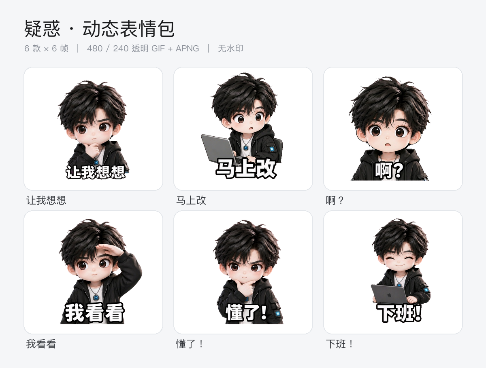

# 慢漫的AI人 · 动态表情包

一张自拍、任意一张图（宠物／手绘／吉祥物／物品），或者一句话，做成一整套**透明底、无水印、会动的表情包**。



*A 组「AI 人日常」实跑成品：Q 版男孩，6 款 × 6 帧*

> 出品：慢漫的AI人（腾讯算法人）　·　公众号矩阵：慢漫的AI人 & 小明同学玩AI
> 项目主页：https://github.com/aimanplay/manman-ai-sticker

**适用环境**：任何能读取 `SKILL.md` 的 Agent（WorkBuddy、Claude Code、Cursor、Codex、ChatGPT 或自建 Agent 均可），**不绑定任何生图模型**。生图只是「产出一张 PNG」的可替换环节：可以用当前 Agent 自带的图像工具、任意图片 API、本机命令行工具，也可以自己在外面生成好再丢进来。脚本只依赖 Python + Pillow + numpy，macOS / Windows / Linux 通用。

## 它做什么

先画一张角色设定图把形象锁死，再让每个表情画成一张多格精灵图，最后切帧合成 GIF。中间有三道机器检查：出图后自动质检（漏字幕、全身小人、背景不纯、水印残留）、背景归一化、去水印。

产出：每个表情的逐帧 PNG、480 / 240 透明 GIF、保留半透明边缘的 APNG、全套总览 GIF、品牌预览卡、可直接分发的 zip。

## 效果示例

两套成品走的是同一套流程，角色和文案组完全不同：

| | 角色 | 文案组 | 字幕 |
|---|---|---|---|
| **A 组**（页首主视觉） | Q 版男孩 · 黑色短发 | AI 人日常 | 让我想想 / 马上改 / 啊？ / 我看看 / 懂了！ / 下班！ |
| **B 组**（本节） | Q 版女孩 · 黑色高马尾 | 算法人职场 | 跑个实验 / 数据不对 / 复现了！ / 再调一版 / 这个能上 / 我先撤了 |

B 组用一张已有的 Q 版女孩全身图起步，保留原画风补全三视图，再出 6 张 3×2 精灵图；每款 6 帧，透明底、无水印。


| 跑个实验 | 数据不对 | 复现了！ |
|:---:|:---:|:---:|
|  |  |  |

| 再调一版 | 这个能上 | 我先撤了 |
|:---:|:---:|:---:|
|  |  |  |

上面 6 个是 240px 透明 GIF，直接会动；再看 6 款同时播放的总览：


> `assets/` 里放的是示例文件。完整 480 / 240 / APNG、逐帧 PNG 与 zip 由 skill 运行时产出，规格见 `references/平台规格与合规.md`。

## 安装

> 仓库地址：https://github.com/aimanplay/manman-ai-sticker　·　仓库根目录即 skill 根目录，`SKILL.md` 就在最外层。

### 一句话安装

在支持 skill 安装的 Agent 里直接发送：

```
请帮我安装这个 Skill：https://github.com/aimanplay/manman-ai-sticker
```

安装器通常会把仓库放进该 Agent 的 skills 目录。**唯一硬性要求：`SKILL.md` 必须在仓库根目录**——本仓库就是这么放的，clone 后不要再往外套一层文件夹。部分 Agent 需要新开一个会话才会加载新装的 skill。

### 手动安装（安装器不认这个地址时）

```bash
git clone https://github.com/aimanplay/manman-ai-sticker.git \
  <skills 目录>/manman-ai-sticker
```

| 环境 | 常见 skills 目录 |
|---|---|
| WorkBuddy | `~/.workbuddy/skills/` |
| Claude Code | `~/.claude/skills/` 或项目内 `.claude/skills/` |
| 其他 Agent | 项目内 `.agents/skills/`，或按该 Agent 文档指定的位置 |

无需构建、无需配置密钥。

### 装依赖并自检

```bash
python3 -m pip install -r <skill目录>/requirements.txt   # Windows：py -3 -m pip install ...
python3 <skill目录>/scripts/check_env.py
```

`check_env.py` 只用标准库，会依次检查 Python 版本、`numpy` / `Pillow`、脚本与规范文件是否齐全、系统有没有中文字体，最后给 PASS / FAIL 和具体修复命令。**建议装完先跑一次**，别等做到一半才撞上 `ModuleNotFoundError`。

`scipy` 可选：装了抠图更快，没装脚本会自动走纯 numpy 实现，结果一致。下文 `python3` 泛指「装好依赖的那个解释器」，Windows 上换成 `py -3` 或 `python`；更稳妥的做法是建虚拟环境，别污染全局。

### 更新

```bash
git -C <skill目录>/manman-ai-sticker pull --ff-only
```

skill 运行时只往工作目录写产物，不会改安装目录里的文件，所以 `git pull` 不会冲突。

## 快速开始

在支持 skill 的 Agent 里说：

```
用这张照片帮我做一套动态表情包
```

```
把这只猫做成表情包 / 帮我做一套上班摸鱼的柴犬表情包
```

它会先探测当前环境可用的生图方式、出角色设定图给你确认、一起定字幕和动作，再批量出图并交付。没有内置生图能力时，会给出 A/B/C 备选让你选。

> **成本与前提**：一套 6 个表情通常要生成 1 张设定图 + 6 张精灵图，共约 7 张，按所用生图工具的计费规则消耗额度／积分，Agent 会在开跑前告知量级。skill 本身不提供生图能力，也不附带任何密钥；上面的「零成本复现」可以完全不花额度验证后处理链路。

> **路径契约**：`SKILL.md` 里所有脚本命令都写 `$SKILL_DIR/scripts/xxx.py` 绝对定位，因为产物工作目录和 skill 安装目录不是同一个；手动复现时把 `<skill目录>` 换成实际路径即可，不要写成相对路径 `scripts/xxx.py`。

只想用脚本：

```bash
P=python3                         # Windows 改成 py -3
S=<skill目录>/scripts

$P $S/qa_check.py 精灵图.png --cols 3 --rows 2                     # 出图后先验
$P $S/clean_bg.py 精灵图.png 精灵图_干净.png --bg "#FF00FF"          # 归一化 + 去水印（真透明底可跳过）
$P $S/make_gif.py 精灵图_干净.png 3 2 gif/让我想想 200 --bg "#FF00FF"
$P $S/overview.py gif 3
$P $S/brand_preview.py gif --title "我的表情包" --out 预览_全套.png
```

`--cols` / `--rows` 按实际网格传：3:2 → 3×2（6 帧）、1:1 → 3×3（9 帧）、16:9 → 4×2（8 帧）。生图后端能直接出真透明 PNG 时，跳过 `clean_bg.py`，改用 `make_gif.py ... --bg auto`。

## 零成本复现（不调用生图、不花积分）

给想先验环境再决定是否开跑的人：仓库自带一张 3×2 精灵图样例 `assets/示例_精灵图.png`，可以完整走一遍后处理链路。

```bash
P=python3
S=<skill目录>/scripts
A=<skill目录>/assets
mkdir -p demo && cd demo
cp "$A/示例_精灵图.png" .

$P "$S/qa_check.py" 示例_精灵图.png --cols 3 --rows 2
$P "$S/make_gif.py" 示例_精灵图.png 3 2 gif/跑个实验 200 --bg "#FF00FF"
$P "$S/overview.py" gif 3
$P "$S/brand_preview.py" gif --title "零成本验证" --out 预览.png
```

跑完拿到透明 GIF、APNG、逐帧 PNG、总览动图和预览卡，就说明依赖、脚本、中文字体全链路正常。这一步只验证后处理；生图环节由当前 Agent 提供，没有内置能力时按 `references/生图方式.md` 的 A/B/C 走。

## 目录结构

```
manman-ai-sticker/
├── SKILL.md                       # 主流程（Agent 读这个）
├── README.md
├── LICENSE                        # 开源许可
├── requirements.txt               # 依赖：Pillow + numpy
├── 经验.md                        # 实测沉淀，开工前读（只读基线）
├── references/
│   ├── 品牌视觉规范.md            # 色板 / 字幕 / 构图 / 提示词模板 / 验收清单
│   ├── 表情文案库.md              # A/B/C 三组场景文案 + 自定义模板
│   ├── 定角色.md                  # 三种起点的角色设定图提示词
│   ├── 生图方式.md                # 多后端适配 + 已验证参数附录
│   ├── 平台规格与合规.md          # 上架自检、授权与 AI 素材注意
│   └── 关于慢漫的AI人.md          # 出品方与公众号矩阵
├── scripts/
│   ├── check_env.py               # 安装后自检（只用标准库）
│   ├── qa_check.py                # 出图自动质检（支持真透明底与自定义底色）
│   ├── clean_bg.py                # 背景归一化 + 去水印（按画面比例定位）
│   ├── make_gif.py                # 切帧 / 对齐 / 透明 GIF / APNG
│   ├── overview.py                # 全套总览 GIF
│   └── brand_preview.py           # 品牌预览卡（跨平台中文字体）
└── assets/                        # 两套实跑示例 + 一张零成本复现用精灵图
```

## 设计要点

- **后端与平台无关**：主流程只要求「一张 PNG」，生图能力靠运行时探测；不写死任何工具的字段名、尺寸或本机路径。
- **规范与执行分离**：配色、字幕、构图写在 `references/`，流程写在 `SKILL.md`，脚本只管执行；改风格不动代码。
- **质量靠机器**：出图后先过 `qa_check.py`，漏字幕、全身小人、渐变底、水印残留直接报 FAIL，不过关就重画，不靠肉眼碰运气。
- **承认模型的不稳定**：生图模型会把纯色底画成渐变、会在右下角强制加水印，流程里内建归一化与清理，而不是反复重画浪费额度；能出真透明的后端则直接跳过这一步。
- **交付即可分发**：480 / 240 / APNG 三种格式 + 总览动图 + 品牌预览卡 + zip，附平台规格与合规自检。

## 许可与使用

代码与文档按仓库根目录 `LICENSE` 的条款使用；转载或二次分发请保留出品信息（「慢漫的AI人」与公众号矩阵备注）。

`assets/` 里的图片与动图**仅作效果演示**，不构成对其中角色形象的素材授权，请勿直接取用为商用素材。两套示例均为本 skill 实跑产出的成品；角色若来自他人照片或他人作品，自用无碍，公开发布或上架表情平台前需取得授权。品牌名称与公众号信息不属于代码许可范围。
